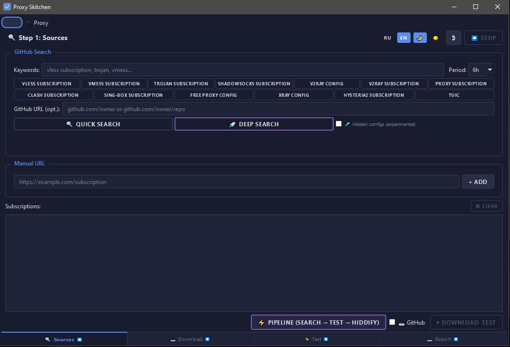

# proxy-skitchen

[](LICENSE)
[](https://www.python.org/)
[](tests/)
[](https://github.com/cyberanrhy/proxy-skitchen/releases)

> Find working proxy servers and subscriptions in minutes.
> Scrape, test honestly, tune TLS profiles, export — all in one desktop app.



---

## Stop hunting for proxies. Let the kitchen do the work.

**proxy-skitchen** finds proxy configs on GitHub, tests them the hard way, and keeps only what actually works from your network.

No «ping passed, so it is alive». No replaced response counted as a success. No dead nodes in the export.

---

## What's new in 3.2

| Feature | Why it matters |
|---|---|
| **Check modes** | *Standard* keeps the fair multi-target check. *Like Happ* reproduces the way Happ reports nodes: one core, one request, fixed timeout, no DoH and no fallback — useful when comparing results with another client. |
| **Stage trail** | Hover a node to see where the check stopped: DNS, TCP, core, probe. No more guessing why a node is dead. |
| **Plain proxies removed** | Open `http://`/`socks://` proxies are unencrypted: they are dropped on load, never tested and never exported. |
| **Happ-style node support** | HTTP and SOCKS proxies are now assembled by the Xray path too, so they behave the same in both clients. |

## What's new in 3.1

| Feature | Why it matters |
|---|---|
| **Fair deep test** | Two independent control targets, content validation, retries, adaptive timeout — a captive portal or a replaced response can no longer pass as a working tunnel. |
| **Per-node TLS profiles** | `fragment` and `uTLS` are chosen **per node**, not globally. One node's winning settings break another's site access — the app now keeps them apart. |
| **Site check** | Verifies that a configurable set of popular sites opens through the tunnel, with 1, 2 or 3 sites required. |
| **Failure reason** | Hover a failed node and see *why*: timeout, connection reset, TLS error, closed port, replaced response. |
| **Single instance** | A second launch brings the existing window back instead of leaving another invisible process. |
| **Tray that works** | The icon is bundled into the executable and drawn as a fallback, so closing the window never leaves a zombie. |

---

## How the test works

```
🔍 Search GitHub  →  ⬇ Download configs  →  🩺 Quick TCP  →  ✅ Fair deep test  →  🧪 TLS profile  →  📦 Export
```

1. **TCP prefilter** — an unreachable TCP port fails in ~2 s without starting a core. UDP protocols (Hysteria2, TUIC) skip this step. If DNS does not resolve at all, the node is *not* marked dead — DoH may still work.
2. **Fair deep test** — the core starts and two control targets are probed: Cloudflare `cdn-cgi/trace` and GStatic `generate_204`.
   - Responses are validated, not just status codes: a `204` with a body, an HTML page or a trace without `ip=`/`colo=` is a failure.
   - Two rounds with early stop: a working node finishes after the first success, a flaky one gets a second chance, a dead one pays for both.
   - Timeout adapts to the measured TCP RTT (3–6 s instead of a fixed 5 s).
3. **Site check** — the same tunnel is used to open a few popular sites. Strictness is configurable: *soft* (1 site), *medium* (2), *strict* (3).
4. **TLS profile search** — for nodes that failed, the app tries deterministic profiles one by one, then confirms the winner with a second fair check, so a lucky packet does not count.

Plain `http://` and `socks://` proxies are dropped before step 1: they carry no encryption, so they are never tested and never exported.

### Check modes

| Mode | What it does | When to use it |
|---|---|---|
| **Standard** | Several control targets, two rounds, adaptive timeout, second core on failure. | Everyday picking: fewer false "dead" verdicts. |
| **Like Happ** | One core, one HEAD request, fixed 5 s, no DoH, no fallback, any HTTP answer counts as alive. | When you want the same verdict another client gives you. |

The mode is switched in the test toolbar. Failed nodes show the stage where the check stopped — DNS, TCP, core or probe.

### TLS profiles

Chosen per node, based on the detected issue:

| Detected issue | Candidates, in order |
|---|---|
| Reset after ClientHello | TLS `fragment` → `uTLS` profiles → as-is |
| Protocol fingerprint | `uTLS` profiles → as-is |
| Unreachable address | alternative CDN port (2053/2083/2087/2096) → as-is |
| Restricted address list | as-is → `fragment` |
| DNS tampering | as-is (the fix is DoH, not a config override) |

`uTLS` profiles: Chrome, Firefox, Safari, randomized. All results stay in the «Profile» column and never leak into other nodes.

---

## What you get

- **Live proxy list** — only servers that passed real HTTP validation and content checks.
- **Any format** — Clash, sing-box, Hiddify, V2RayN, Amnezia, or plain URI list.
- **All major protocols** — VLESS, VMess, Trojan, Shadowsocks, Hysteria2, TUIC.
- **Hidden configs** — scrapes base64 subscriptions and inline URIs embedded in text.
- **Scan GitHub user repos** — paste `https://github.com/user` and scan all their repos.
- **WireGuard search** — dedicated `wireguard://` mode with copyable output for AmneziaWG.
- **Country flags** — see where each server is located.
- **SOCKS5 download proxy** — route downloads through a local proxy when GitHub is unreachable from your network.
- **Tray + single instance** — close hides to tray, a second launch restores the window.
- **i18n** — Russian and English, follows the system language.
- **Privacy first** — no accounts, no telemetry, no cloud. Everything runs locally.

---

## Supported protocols

| Protocol | Parse | Test | Export |
|----------|-------|------|--------|
| VLESS | ✓ | ✓ | ✓ |
| VMess | ✓ | ✓ | ✓ |
| Trojan | ✓ | ✓ | ✓ |
| Shadowsocks | ✓ | ✓ | ✓ |
| Hysteria2 | ✓ | ✓ | ✓ |
| TUIC | ✓ | ✓ | ✓ |
| WireGuard | ✓ | – | – |

---

## Download

Grab a ready build from [Releases](https://github.com/cyberanrhy/proxy-skitchen/releases):

| File | Platform |
|---|---|
| `proxy-skitchen-windows.exe` | Windows 10/11, windowed |
| `proxy-skitchen-cli-windows.exe` | Windows, console build for CLI commands |
| `proxy-skitchen-macos` | macOS |
| `proxy-skitchen-cli-macos` | macOS, console build |
| `proxy-skitchen-linux` | Linux |
| `proxy-skitchen-cli-linux` | Linux, console build |

Each executable is a single self-contained file (PyInstaller onefile). The CLI builds run the same app and start the GUI when launched without arguments.

### Deep test needs a core

The app does not ship sing-box or xray inside the executable. Put them here:

| Platform | sing-box | xray |
|---|---|---|
| Windows | `%LOCALAPPDATA%\sing-box\sing-box.exe` | `%LOCALAPPDATA%\xray\xray.exe` |
| Linux / macOS | `/usr/local/bin/sing-box` | `/usr/local/bin/xray` |

- `sing-box` — needed for any deep test (VMess, Trojan, Shadowsocks, Hysteria2, TUIC, VLESS with `ws`).
- `xray-core` — needed for VLESS REALITY over `tcp`/`grpc`/`xhttp`.

Without cores the app still parses, filters and exports configs, and the quick TCP test works.

---

## Quick start

### Linux / macOS

```bash
git clone https://github.com/cyberanrhy/proxy-skitchen.git
cd proxy-skitchen
pip install -r requirements.txt
python3 -m proxy_skitchen
```

### Windows

```bash
git clone https://github.com/cyberanrhy/proxy-skitchen.git
cd proxy-skitchen
pip install -r requirements.txt
python -m proxy_skitchen
```

---

## CLI mode

```bash
# Search and save
python3 -m proxy_skitchen search "vless subscription" --output sources.txt

# Full pipeline: search → test → save
python3 -m proxy_skitchen pipeline "vless subscription" --deep --output working.txt

# Quick TCP test
python3 -m proxy_skitchen test 1.2.3.4 443

# Test every URI in a file
python3 -m proxy_skitchen test-file proxies.txt --deep --output working.txt

# Read a subscription and re-export it
python3 -m proxy_skitchen export sources.txt --format clash

# Replace DNS with DoH in an existing config
python3 -m proxy_skitchen fix-dns config.json
```

Run `python3 -m proxy_skitchen menu` for the interactive menu, or `--help` for every option.

---

## Building from source

```bash
pip install pyinstaller
pyinstaller proxy-skitchen.spec        # GUI build
pyinstaller proxy-skitchen-cli.spec    # console build
```

Output lands in `dist/`. On Windows the spec uses `proxy_skitchen/icon.ico` (PyInstaller rejects PNG there without Pillow); other platforms use `icon.png`.

Tagged builds are produced by GitHub Actions for Windows, macOS and Linux and published as release assets.

---

## Tests

```bash
python -m unittest discover -s tests -t .
```

160 tests cover fair probing, attempt summaries, failure classification, Happ-compatible checks, plain-proxy filtering, strategy candidates, engine routing, exporter overrides, threading contracts, table model and single-instance behaviour.

---

## Support the project

Donations go through Boosty:

[**boosty.to/skitchen**](https://boosty.to/skitchen)

---

## License

MIT
